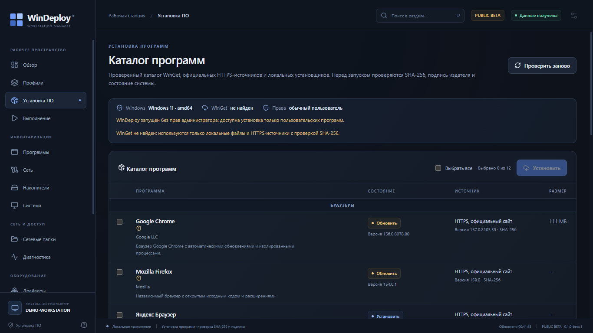
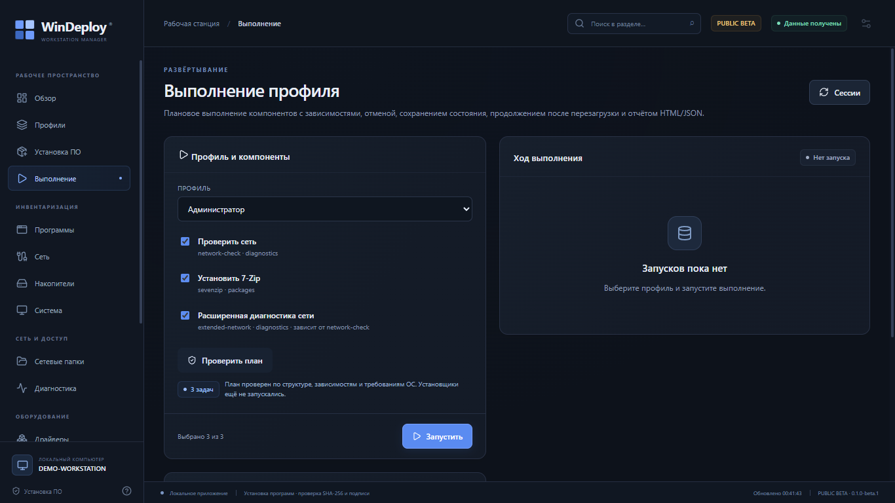

# WinDeploy

**Public Beta — software under active development.** Инструмент подготовки рабочих
станций Windows 11: инвентаризация, профили, установка выбранных программ,
диагностика сети, SMB-ярлыки и отчёты. Проект ещё не stable; перед использованием
на рабочей машине прочитайте [Known Issues](docs/KNOWN_ISSUES.md).

[](docs/images/catalog-beta.png)

## Что уже работает

- **Inventory** — компьютер, CPU, память, тома, сеть и установленные программы;
  read-only, частичные ошибки показываются явно.
- **Профили** — строгий YAML, наследование, зависимости и предварительный план без
  выполнения.
- **Установка ПО** — каталог закреплённых программ, detection, SHA-256/подпись,
  явный выбор пакетов и отдельное подтверждение. Прогресс, отмена, результаты и
  warnings отображаются в GUI.
- **Диагностика сети** — DNS/DHCP/шлюз/TCP/ICMP/HTTP/SMB, только чтение.
- **Сетевые папки** — UNC, Windows Credential Manager, обработка конфликта 1219
  только после подтверждения и ярлыки на рабочем столе.
- **Выполнение** — preview плана, подтверждение, живой прогресс, сохранение
  сессии, HTML/JSON-отчёт. Экран выполнения требует сначала проверить план.
- **Честные результаты** — нет `Success`, если обязательный эффект не подтверждён;
  предупреждения сохраняются в результате, сессии и отчёте.

[](docs/images/execution-beta.png)

Скриншоты сделаны из настоящего Modern GUI; hostname заменён на
`DEMO-WORKSTATION`, персональные данные не публикуются.

## Поддерживаемые ОС

| ОС | Статус beta |
|---|---|
| Windows 11 x64 | Основная и проверенная платформа |
| Windows 10 x64 / LTSC | Не проверялась; поддержка не заявляется |
| Windows 7 SP1 / Legacy | **FROZEN**, в beta-артефакт не входит |

Нужен Microsoft Edge WebView2 Evergreen Runtime. WinDeploy не устанавливает его
автоматически.

## Установка

Релиз `v0.1.0-beta.1` готовится. После публикации файлы будут доступны в
[Releases](https://github.com/OWNER/WinDeploy/releases); `OWNER` заменяется
владельцем репозитория до открытия исходников.

1. Скачайте `WinDeploy-Windows-x64.exe` из Assets.
2. Проверьте SHA-256 по `SHA256SUMS.txt`.
3. Запустите EXE — установка не требуется.
4. При первом запуске выполняется read-only Inventory. Изменяющие операции
   требуют явного подтверждения и обычно прав администратора.

EXE **не подписан** сертификатом code signing; SmartScreen может показать
предупреждение. Не запускайте файл из неизвестного источника.

## Первый запуск

1. Дождитесь завершения Inventory на странице «Обзор».
2. Откройте «Профили», выберите рабочее место и нажмите «Построить план».
3. Проверьте зависимости, требования ОС и предупреждения.
4. Для установки выберите программы на странице «Установка ПО», затем нажмите
   «Установить» и подтвердите запуск. Без прав администратора системные пакеты
   блокируются до первой операции.
5. На странице «Выполнение» постройте план и подтвердите запуск профиля.
6. Результаты и HTML/JSON-отчёт доступны после завершения. При ошибке откройте
   «Журнал» и укажите версию/Windows build в Issue.

Если Windows не позволяет записать данные WebView2 в `%LOCALAPPDATA%`, WinDeploy
пробует резервный каталог, `%TEMP%` и портативный `WinDeploy-WebView2` рядом с
EXE. При использовании резервного каталога появляется нативное окно с кнопками
«Да» (перезапустить от имени администратора через UAC) и «Нет» (продолжить с
резервным каталогом). Существующие данные WebView2 не удаляются, ACL не
переписывается.

Пример сценария: установить 7-Zip → проверить detection и повтор → построить
профиль «Офис» → выполнить диагностику сети → открыть отчёт. Не запускайте
изменяющие операции на рабочей машине без резервной копии.

## Ограничения beta

- Реальные установка/обновление/отмена пакета, SMB-сервер и reboot acceptance
  ещё не закрыты на чистой Win11 VM. См. [BETA_READINESS](docs/BETA_READINESS.md).
- Драйверы, добавление принтеров, политики браузеров и изменение параметров
  Windows — **экспериментальные**, без VM-приёмки. Добавление TCP/IP-принтера
  может не создать порт.
- Отмена установщика не гарантирует остановку дочерних процессов.
- Session owner/ACL — не аутентификация и не защита от same-user/administrator
  tampering.
- Нет автообновления; каталог и версии закреплены.
- Windows 10/LTSC и Windows 7 не поддерживаются в beta.
- Лицензия ещё не выбрана; публичное открытие исходников заблокировано до решения
  владельца.

Полный список: [docs/KNOWN_ISSUES.md](docs/KNOWN_ISSUES.md).

## Безопасность

- User-scoped изменения требуют совпадения SID процесса и владельца интерактивного
  shell; unknown/mismatch fail closed.
- Session-файлы ограничены по размеру, строго декодируются, проверяются по ID,
  owner и write-ACE перед изменяющим resume.
- Установщик принимается только при совпадении SHA-256/Authenticode-политики.
- Пароли SMB не пишутся в отчёт; отчёты не содержат parameters задач.

Не публикуйте пароли, токены, приватные IP, имена пользователей и корпоративные
пути в Issues. Уязвимости — через GitHub private vulnerability reporting; см.
[SECURITY.md](SECURITY.md).

## Сборка для разработчиков

Требования: Windows 11 x64, Go 1.20.14 для root, Go 1.26.2 для Modern, Node.js
24.x, Wails CLI v3.1.0.

```powershell
# Root: Go 1.20, amd64+386 test/vet/build
./scripts/test-core.ps1 -Go <path-to-go1.20.14> -BuildCache ci-go120

# Modern: bindings, UI tests, strict TypeScript/Vite, Go tests/vet, Wails EXE
./scripts/build-modern.ps1 -Diagnostic

# Согласованность версии и release-артефакты
./scripts/verify-version.ps1
./scripts/package-modern-release.ps1 -SkipBuild
```

Артефакты — `bin/` и `dist/`. Подробности: [docs/modern.md](docs/modern.md),
[docs/release.md](docs/release.md), [CONTRIBUTING.md](CONTRIBUTING.md). Legacy
Windows 7 FROZEN; не запускайте Legacy-сборку как часть Modern beta.

## Обратная связь

- [Issues](https://github.com/OWNER/WinDeploy/issues) — шаблоны Bug report и
  Feature request.
- [Releases](https://github.com/OWNER/WinDeploy/releases) — артефакты и
  SHA256SUMS после публикации.
- [BETA_READINESS](docs/BETA_READINESS.md) — что проверено, что отключено и какие
  блокеры остаются.
- [CHANGELOG](CHANGELOG.md) — изменения версии.

## Документация

- [Архитектура](docs/architecture.md)
- [Modern GUI](docs/modern.md)
- [Пакеты](docs/packages.md)
- [Сеть](docs/network.md)
- [Выполнение и отчёты](docs/execution.md)
- [Драйверы и принтеры](docs/drivers-printers.md)
- [Браузеры и настройки](docs/browsers-settings.md)
- [Inventory](docs/inventory.md), [профили](docs/profiles.md)
- [Известные проблемы](docs/KNOWN_ISSUES.md), [публикация](docs/PUBLICATION_CHECKLIST.md)
- [TASKS](TASKS.md), [HANDOFF](HANDOFF.md)

## Лицензия

Лицензия не выбрана. `LICENSE` — осознанная заглушка; публичное открытие
исходников и распространение исходного кода заблокированы до решения владельца.
